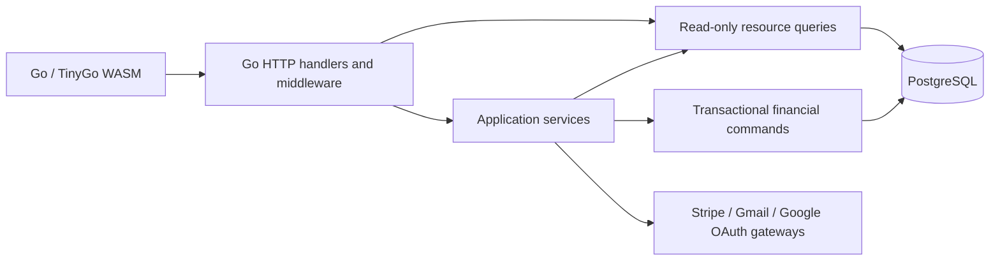

# Trip Manager architecture and decision guide

Last reviewed: **23 November 2026**. Source checkpoint: `23bcf5e` on
`codex/project-improvements`.

This is the primary architecture handoff for future project sessions. It describes
implemented behavior, accepted decisions and known limitations. Read [AGENTS.md](AGENTS.md)
for development instructions. Source code and migration history take precedence
if this guide drifts; update the guide when resolving that drift.

## Quick context for a new session

- This is a **layered Go monolith with a Go/TinyGo WASM browser client**, backed by
  PostgreSQL. A microservice or JavaScript-framework rewrite is not an agreed goal.
- HTTP handlers own transport; stores own SQL; services coordinate business rules
  and transactions. Read-only handlers may call a store directly.
- Ordinary resources have largely migrated to stores/services. Core authentication
  now has its own service/store too. Legacy compatibility helpers remain; do not
  assume every function under `dbAuthTemplate` is migrated or unused.
- Checkout/refunds already use services, gateways and transactional ledger commands.
  Do not move their writes into generic CRUD.
- Authorization is a **resource + HTTP method + access scope** grant through groups.
  UI visibility is not authorization, and `own` is not interchangeable with `any`.
- Default API/Compose builds compile fresh WASM from source. An explicit
  `CLIENT_IMAGE` override deliberately selects a prebuilt artifact.
- Voucher migrations **0030** and **0031** add vouchers, redemptions and checkout
  cutoff snapshots. **0032** adds edit versions to vouchers and group bookings.
  Check the target migration ledger and runtime grants before replacing an API image.
- No guide or historical verification record authorizes live migrations, deployment,
  data changes or external provider calls. Follow the current user's authorization.

## 1. Components and dependency direction



This diagram shows responsibilities, not separate deployed services. Background
notification and payment-recovery workers run within the API process and use
durable database state.

| Location | Responsibility / starting point |
|---|---|
| [`api-server/main.go`](api-server/main.go) | API composition, router construction and HTTP/TLS server startup |
| [`api-server/app/appCore/`](api-server/app/appCore/) | Settings, dependency initialization, DB pool, integration availability and worker lifecycle |
| [`api-server/localHandlers/`](api-server/localHandlers/) | Routing, authentication/capability middleware, request decoding and response mapping |
| [`api-server/app/services/`](api-server/app/services/) | Account, authentication, booking, trip, pricing, security, notification, checkout and finance workflows |
| [`api-server/modelMethods/`](api-server/modelMethods/) | SQL-only resource stores, query/pagination helpers and transactional ledger commands; also contains legacy adapters |
| [`api-server/models/`](api-server/models/) | Domain/database models, write DTOs, validation rules and exact money types |
| [`api-server/app/gateways/`](api-server/app/gateways/) | External provider adapters |
| [`api-server/migrations/`](api-server/migrations/) | Authoritative embedded SQL migrations, checksums and runtime grant policy |
| [`client1/app/`](client1/app/) | Browser application state, transport, generated API DTOs, events and callback ownership |
| [`client1/service/`](client1/service/) | Browser booking cache and API-facing coordination |
| [`client1/views/`](client1/views/) | DOM views and shared form/dialog/action helpers |
| [`api-server/static/`](api-server/static/) | Browser bootstrap, styles, runtime configuration integration and packaged WASM assets |

The repository root is not a Go module. `api-server/` and `client1/` are separate
modules. Historical SQL under `db-server/sql/postgreSQL/` is not the authoritative
migration mechanism.

## 2. Go API and routing

`buildRouter` in `main.go` separates three boundaries:

1. **Public routes:** authentication entry points, selected registration lookups,
   content and Stripe webhook reception. Public registration is deliberate, not
   a fallback for endpoints with missing permissions.
2. **Session routes:** operations that require a valid session without the ordinary
   resource-capability check.
3. **Protected resource routes:** session authentication followed by capability
   approval, with record-level scope enforcement in the handler/service/store.

[`CapabilityRoute` and `AddRouteGroup`](api-server/localHandlers/helpers/routeGroups.go)
declare the permission resource alongside the path. Middleware reads the matched
route declaration; it does not infer permissions from URL segments. Nested routes,
aliases and custom commands must declare the intended canonical resource explicitly.
Route tests check the protected inventory and verify canonical resource names and
session requirements on representative nested, checkout, and alias routes.

The router also provides request tracing/deadlines, deliberate CORS configuration,
trusted-proxy handling, `/livez`, `/readyz`, `/client-config.js` and static serving.
The server implements timeouts, TLS and graceful shutdown. Integration availability
is a local configuration/initialization signal, not proof of successful provider use.

**Contract policy:** preserve existing paths, JSON fields and array response shapes
unless a contract change is intentional. Use explicit write/response DTOs; a database
model is not automatically a safe public response. Shared errors use
`{ "error": { "code": "...", "message": "..." } }`; legacy response compatibility
remains where required. Generated DTO/OpenAPI coverage is substantial but incomplete.

See [API contracts](docs/api-contracts.md) and [pagination](docs/api-pagination.md).

## 3. PostgreSQL and transactional integrity

- `sqlx` is the primary database-access approach. Stores use parameterized SQL,
  explicit projections and request contexts. The application configures a bounded
  connection pool and connection lifetime/idle limits.
- Stores contain persistence operations, not HTTP response writing. Services own
  multi-step validation and transactions; handlers translate errors to HTTP.
- Collections use bounded offset pagination and cursor navigation where supported.
  Cursor pages are navigation, not a transactionally consistent snapshot across requests.
- Use database constraints as a final integrity boundary, alongside application
  validation. Dynamic SQL identifiers/order clauses must be internally allowlisted.
- Migration owners and runtime roles are separate. Runtime grants are explicit;
  creating a new table does not automatically grant runtime access. Restricted audit
  and queue permissions must remain restricted.
- `schema_migrations` records migration names/checksums. Startup/readiness check schema
  compatibility; startup does not silently apply migrations. Never edit applied
  migrations or historical dumps to implement a schema change.
- Migration 0033 adds `compatible_since` to the ledger without changing application data.
  The migration runner records an explicit compatibility floor for a tested expansion
  in the same transaction as the schema change. API readiness requires every embedded
  migration and checks its checksum. An API built with this policy may also accept newer
  ledger entries when each entry declares a floor the binary supports. The migration
  runner still rejects unknown entries. Pre-0033 binaries require a coordinated cutover.

**Concurrency:** account/profile writes carry database versions from migration 0025.
Migration 0029 extends this to trips, trip prices and trip price groups.
Migration 0032 adds voucher and group booking versions with a default of 1 for
existing rows. An update trigger advances each version. The migration also
handles audited schema adoption when the columns already exist. Protected PUTs
require the version returned by the latest read and respond with
`409 stale_record` for missing or stale versions. The editors preserve unsaved
input and offer a confirmed reload. Apply 0032 before starting the matching API.
Migration 0034 applies the same mechanism to security group definitions, grants,
and memberships. The browser sends the version captured with the record, and
the update predicate protects the write and its audit transaction. Explicit
response DTOs and generated API and WASM contracts preserve the existing JSON
fields and include the version. Existing records start at version 1.

**Identity:** migrations 0026/0027 enforce normalized nonblank member-code uniqueness
and allocate codes on insertion, preserving all ID digits. Existing duplicate codes
require owner reconciliation; migrations do not silently rewrite member identities.

**Financial invariants:** checkout preparation/finalization, payments, refunds and
derived booking status stay in [`paymentLedger`](api-server/modelMethods/paymentLedger/)
and the corresponding services. Preserve immutable quotes, provider references,
audit/event history, ownership and trip-before-booking lock order. Provider callbacks
and recovery are retry-safe/idempotent; provider results and webhook signatures are
validated. External calls must not run while holding business database locks.
Use exact decimals or integer minor units at provider boundaries. Voucher fixed-price
writes now remain exact from JSON decoding through PostgreSQL persistence; legacy
read DTOs retain compatibility representations.

See [runtime database permissions](docs/runtime-database-permissions.md),
[payment operations](docs/payment-operations.md), [notifications](docs/booking-notifications.md)
and [operational monitoring](docs/operations-monitoring.md).

## 4. Authentication and group-based permissions

Active authentication methods are email OTP, bcrypt password verification followed
by email OTP, and Google OAuth. They converge on database-backed session cookies.
SRP/WebAuthn references in old notes are not evidence of an active implementation.

[`services/authentication`](api-server/app/services/authentication/) and
[`modelMethods/authentication`](api-server/modelMethods/authentication/) now cover
principal/account reads, identity linking, token issuance, registration, OTP login,
OAuth enrollment and email verification. Registration proof consumption and account
creation are one transaction. OTP proof consumption, account checks and session
creation are one transaction. Failed writes roll back proof consumption; successful
proofs cannot be replayed. Passwords are hashed before pending-registration persistence;
bearer tokens are stored as digests. Preserve secure, HTTP-only, same-site cookies.

OAuth callback state is bound to the initiating browser, uses PKCE and is separate
from registration continuation. Verified provider identity is required for linking.
Linking changes only identity fields and checks current account state. Enrollment
updates only permitted profile fields with concurrency checks; it must not overwrite
passwords or administrative activation decisions.

Password reset and logout use the authentication service and store. Reset still
consumes the proof, changes the password and invalidates sessions transactionally.
Login account lookup and legacy login-token issuance use the same service. The
registration proof and hashed profile are inserted together, and failed delivery
discards the pending proof. `dbAuthTemplate` retains compatibility entry points.
OTP delivery cleanup also uses the authentication service and scopes deletion to
the issued proof and its account. OAuth session issuance uses the same token store.

Permissions are grants through user groups for a resource, HTTP method and scope.
The protected middleware reads grants through the
[authentication store](api-server/modelMethods/authentication/capability.go).
Legacy entry points delegate capability queries to that same store.
[`SupportsScope`](api-server/app/authorization/scope.go) rejects unsupported ownership
semantics. Middleware approval does not establish ownership of a particular record;
enforce access on collections, individual/nested records, mutations and referenced parents.
Role names displayed by the UI are not the authorization mechanism.

**Owner-approved Trip List policy:** standard users may see all trips and participant
names, respecting hidden profiles. Migration 0028 grants the standard User group
`GET tripsReport any` and removes its unsupported `own` report grant. This does not
grant other users' booking mutations, broader account reads or finance administration.

## 5. WASM frontend and UI conventions

The client uses Go/TinyGo plus `syscall/js`, not a separate SPA framework. Runtime
`/client-config.js` supplies the API prefix; requests use the current origin rather
than a compiled localhost address. Browser code belongs in `client1/`; do not hand-edit
generated WASM or the compiler-supplied `wasm_exec.js`.

- Use the existing transport/API adapters and generated contracts. The generated
  `finance_generated.go` and `finance.openapi.json` names are historical: they also
  cover booking, trip, pricing, account and security contracts.
- `LoadScope` owns a view's request generation and context. Cancel loads on hide/reset,
  and reject obsolete results before changing records, cursors or DOM. Cancellation
  cannot undo a server-side commit; reload authoritative state before retrying an
  uncertain mutation.
- `domEvents` owns callbacks/listeners and releases removed subtrees. Dialogs are
  view-owned, cancellable and restore focus. Avoid new unmanaged `js.Func` callbacks.
- Inline account forms capture their own record/fields and use account-specific IDs.
  Never let one form submit another form's current-record state.
- Inline membership forms capture their own record version and select element,
  have unique control IDs and focus the select on open. Security editors offer
  confirmed reload for concurrent changes.
- Shared helpers provide validation feedback, busy states, empty states and confirmation
  dialogs. Conflicts preserve edits and offer confirmed discard/reload; cancellation
  preserves the form. Operation results are announced through a persistent
  status region even when message history is collapsed.
- `Action`/`ActionFor` declare permission method/resource metadata at construction.
  Visibility must not depend on button text. The server remains authoritative.
- Native buttons, expanded/controls attributes, focus styles, wrapping layouts and
  viewport settings support keyboard/mobile access. Continue applying these patterns
  when touching older views; existing checks are not a complete accessibility audit.
- Trip List pages trip summaries, fetches bounded participant pages on expansion,
  and cancels pending detail loads when the view is left. Its booking action
  stays disabled during a summary refresh. The legacy full report API remains
  compatible.
- The member Trip List requests the `tripsReport` schedule view, which filters by
  month overlap, type, and grade before paging by start date and ID. Its filter
  values can be shared in the page URL. The filter options use the same report
  capability as the schedule. Schedule summaries include display metadata and
  descriptions, while participant records continue to load on expansion.
- The bootstrap loads the base theme before the component styles. The schedule
  filter panel and sign-in card use the shared surface, border, and radius
  settings, and both inherit the base font.
- Trip edit forms load difficulty, status, type, and cost-group options before
  rendering. The view cancels the lookup on hide or reset and offers Retry on failure.
- Make Booking's Add Person form uses
  [`userView.NewPersonAutocomplete`](client1/views/userView/personAutocomplete.go)
  for one visible input with suggestions below it.
  [`bookingPeopleView`](client1/views/bookingPeopleView/bookingPeopleView.go)
  supplies `GET /bookings/{id}/bookingPeople/lookup` and validates the separately
  stored person ID before saving. The endpoint searches display names and returns
  up to 25 matches, subject to booking access and person visibility. The picker
  searches after two characters and a 250 ms pause. It uses `domEvents.Timeout`
  for the delay and `LoadScope` with `RequestContext` to cancel superseded requests
  and discard late responses. Users can select by keyboard or pointer. Editing
  the text clears the ID. Existing participants use their saved display name,
  with lookup by ID if the name is missing.
- Test compiler-sensitive code in both builds. A real TinyGo startup failure was caught
  during the conflict changes. The current code uses typed error unwrapping and direct
  JSON destination pointers instead of introducing unsupported reflection paths.

See [browser lifecycle](docs/frontend-lifecycle.md) and
[the implementation/verification record](docs/authentication-ui-release-follow-up.md).

### My Bookings form and draft actions

My Bookings loads Trip choices when the booking form opens. The bounded
`GET /myBookings/trips` route uses the `myBookings` read capability and returns
trip IDs, names, and dates. The form shows loading, an empty result, or an
in-view retry. Leaving or resetting the view cancels the lookup. The booking
list uses the booking status,
checkout session, and payment history to hide draft actions for locked bookings.
Participants remain visible in read-only mode. The API enforces booking and
participant write restrictions, including when a full refund leaves a zero balance.

## 6. Docker, runtime configuration and release operations

Default [`Dockerfile.apibuild`](Dockerfile.apibuild)/Compose builds compile the frontend
from source and package the matching WASM/runtime pair. [`Dockerfile.client1`](Dockerfile.client1)
also supports separate artifacts. Compiler-stage parity is checked to prevent drift.
Keep toolchain versions/digests aligned; do not upgrade them incidentally.

| Setting / entry point | Meaning |
|---|---|
| `CLIENT_BUILDER` | Docker build argument selecting `go-builder` or `tinygo-builder` |
| `TM_CLIENT_BUILDER` | Compose input for the self-contained frontend build |
| `CLIENT_IMAGE` | Explicit prebuilt artifact override; omit it for the self-contained default |
| `api-server/.env` | API runtime and Compose interpolation file for all profiles, including development mode, email redirection and Stripe test mode |
| `TM_API_DATA_SOURCE` | Explicit Compose override for runtime `DATA_SOURCE`; otherwise Compose supplies `DB_*` |
| `TM_DB_SSLMODE` | Compose sets DB_SSLMODE for the DB_* fallback. The local default is disable. Set verify-full and configure a trusted CA for remote PostgreSQL. |
| `TRUSTED_PROXY_CIDRS` | Deliberate trust boundary for forwarding headers |
| `EMAIL_REDIRECT_ALL` / `EMAIL_REDIRECT_TO` | Redirect application mail to one defined inbox; Compose uses corresponding `TM_` inputs |
| `STRIPE_TEST_MODE` | Requires configured test credentials and rejects live provider responses/events; it does not convert live keys |

Production disables development authentication defaults. Test flags are separate
deployment choices; production deployment validation rejects enabled/ambiguous test
settings. Never read out or commit real env files, credentials or tokens for documentation.

The final API image runs as UID 10001 with read-only filesystem, temporary `/tmp`,
dropped capabilities and runtime-mounted credentials. PostgreSQL 17 uses its own data
volume; the older volume is retained for an explicitly managed rollback, not attached
to a newer server. Database/Adminer/debug ports are locally restricted; Adminer requires
the tools profile. Select final, interactive and debug targets deliberately.

`scripts/build-application.ps1` builds both components, records the source revision,
marks dirty builds and optionally requires a clean tree. It starts no containers and
applies no migrations. Default `docker compose --env-file api-server/.env --profile prod up --build -d` now builds
both components unless an explicit prebuilt override is supplied. Recreating a container
alone does not rebuild artifacts. Use BuildKit; routine cache pruning is not required.

Published builds default to building the client from source. When supplied a
prebuilt client digest, the release builder checks its compiler and source
revision labels. The deployment script checks the API image digest and revision,
checks the schema and effective database grants with the candidate image and target
runtime account, waits up to 120 seconds for API health, and leaves database
dependencies running. `-Preflight` runs these identity, configuration and database
checks without replacing the API.

Immutable production image approval, monitoring and recovery are separate operator
actions: see [release operations](docs/release-operations.md),
[PostgreSQL upgrade](docs/postgres-upgrade.md) and [test-mode controls](docs/test-mode.md).

## 7. Accepted decisions and reasons

| ID | Decision | Reason / consequence |
|---|---|---|
| TM-01 | Keep the layered monolith; migrate incrementally | Preserve tested contracts and focus changes; no general rewrite is approved |
| TM-02 | Declare route capabilities explicitly | URL layout, nested paths and API prefix must not determine authorization |
| TM-03 | Enforce ownership separately from capability approval | An allowed method does not authorize another user's records or parent references |
| TM-04 | Keep financial writes in ledger commands/services | Preserve atomic state, provider idempotency, recovery and audit history |
| TM-05 | Couple one-time proofs with their database action transaction | A transient failure must not strand an otherwise valid registration/login |
| TM-06 | Use narrow OAuth/account commands and explicit DTOs | Prevent accidental credential disclosure or overwriting concurrent account decisions |
| TM-07 | Separate migration owner and explicit runtime grants | Runtime credentials must not become schema owners or gain automatic future access |
| TM-08 | Return versions on protected full-edit workflows | Row locks alone cannot detect a stale browser form |
| TM-09 | Preserve Go and TinyGo, with matching runtime assets | Host compilation or one compiler's success does not prove browser compatibility |
| TM-10 | Build frontend and API together by default | Prevent the stale-WASM packaging failure seen with the earlier Compose workflow |
| TM-11 | Standard members can read the global redacted roster | Explicit owner decision; retain hidden-profile protections and booking ownership |
| TM-12 | Keep test delivery/payment flags explicit | Testing must not accidentally contact real recipients or accept live payment activity |
| TM-13 | Declare backward-compatible expansions explicitly | Enable verified application rollback across compatible migrations while preserving required checksum checks and coordinated cutovers for other changes |

## 8. Completed changes versus remaining limitations

The dated [first follow-up](docs/architecture-ui-follow-up.md) and
[subsequent follow-up](docs/authentication-ui-release-follow-up.md) preserve details
and verification evidence. Their deployment observations are historical.

| Completed area | Result |
|---|---|
| Resource boundaries | Stores/services for catalogs, group bookings, participants, vouchers and other core resources; Trip Type create-table regression fixed |
| Account safety | Address limits aligned; shared error DTOs; account/profile versions; unique member codes; isolated inline forms |
| Authentication | Core service/store including capability lookup, route inventory and alias checks, narrow OAuth changes, atomic registration/login and request-context propagation |
| Money/concurrency | Exact voucher writes, trip and pricing versions in 0029, and voucher and group booking versions in 0032 |
| UI | Capability actions, conflict recovery, keyboard controls, cancellable rosters, status announcements, and reliable trip edit lookups |
| Build/verification | Self-contained frontend/API build, compiler parity and artifact identity checks, deployment health wait, and expanded browser checks |

**Remaining limitations / follow-up candidates, not claims of completed work:**

| Priority | Area | Guidance |
|---|---|---|
| Medium | Partial concurrency coverage | Catalogs and other resources still have unversioned edits. Extend deliberately where concurrent full edits pose a material risk; update callers and tests together |
| Medium | Legacy persistence/adapters | Compatibility and generic helpers remain. Check actual production callers before removing them |
| Medium | Contract and validation coverage | Some legacy resources still reuse models or handwritten contracts. Extend explicit DTOs and resource-specific validation as features change; the generator is not complete domain validation |
| Medium | UI duplication and accessibility | Continue shared components, unique control IDs and lifecycle ownership. Manual screen-reader, device and broader visual audits remain necessary |
| Operational | Environment and provider acceptance | Recheck actual migrations, roles, monitoring installation and required integrations. Automated provider fakes do not establish real Gmail/Google/Stripe readiness |
| Low / conditional | Build/configuration maintenance | Record approved artifact digests, keep compiler stages aligned, and verify database TLS settings and trust roots for remote deployments |

No additional wholesale checkout migration is required by this checkpoint. Its
service/ledger boundary is the pattern to preserve, not unfinished generic CRUD work.

## 9. Verification and deployment handoff

Relevant commands from the repository root:

```powershell
./scripts/verify-release.ps1
./scripts/audit-dependencies.ps1
./scripts/verify-postgres-upgrade.ps1
```

Release verification checks generated contracts/configuration policies, both frontend
builds, Deno-hosted WASM package tests, API/PostgreSQL tests and vet, packaged runtime/Chromium,
health and graceful shutdown. Dependency audit and upgrade rehearsal are additional
checks, also wired into CI. CI covers pull requests and pushes to `main` and
`codex/project-improvements`; do not infer a remote run passed from a local result.

On 23 November 2026, full release verification passed locally for `23bcf5e`.
The exact Go-built rollout image also passed Chromium smoke verification.
Checks covered session and ownership rules, account forms and conflicts, trip
edit and booking flows, status announcements, keyboard navigation, and mobile overflow.

The [Chromium booking smoke test](scripts/release-smoke.mjs) exercises Add Person
by typing a name, selecting a match with the keyboard, editing the text to clear
the selection, and selecting again before saving the participant.

The same revision was deployed to the local Compose stack after a database
backup and grant check. Migration 0032 was recorded, the API passed readiness,
and the operations check reported zero alerts. External alert delivery,
live provider integrations, and manual screen-reader and device checks remain
unverified at this checkpoint.

For an **authorized local rollout**, prepare runtime settings/backup and verify
migration/grant state first. The local helper prompts for the migration owner's
password, applies pending migrations and refreshes runtime grants:

```powershell
./scripts/build-application.ps1 -RequireClean
./scripts/migrate-local.ps1
docker compose --env-file api-server/.env --profile prod up -d --no-deps --no-build --force-recreate --wait --wait-timeout 120 apiserver
docker compose --env-file api-server/.env --profile prod exec apiserver /app/tm-operations-check
```

These commands are guidance, not actions performed by reading/updating this guide.
Pre-0033 APIs check the exact migration ledger and reject newly applied migrations.
Coordinate the 0033 and 0034 migrations and API replacement to limit downtime. Use the production
release procedure for production. Recheck schema compatibility
before rollback; do not restore old financial data to simplify an application rollback.

## 10. Keeping future sessions consistent

1. Read `AGENTS.md`, this quick context and the section relevant to the task. Open
   detailed runbooks/source only as needed; do not reconstruct the entire chat history.
2. Check branch/worktree state and preserve unrelated changes. Treat historical
   deployment/test observations as dated evidence, not current environment state.
3. Keep changes within the established handler/service/store/gateway boundaries.
4. Record new decisions here with a stable ID, reason, affected boundaries and whether
   they are implemented or proposed. Mark superseded decisions explicitly.
5. Update migration requirements, compatibility notes, tests actually run and remaining
   limitations with the implementation. Keep secrets and real user data out of examples.
6. For future architecture reviews, distinguish completed fixes from new findings,
   residual compatibility code and external operational acceptance work.
